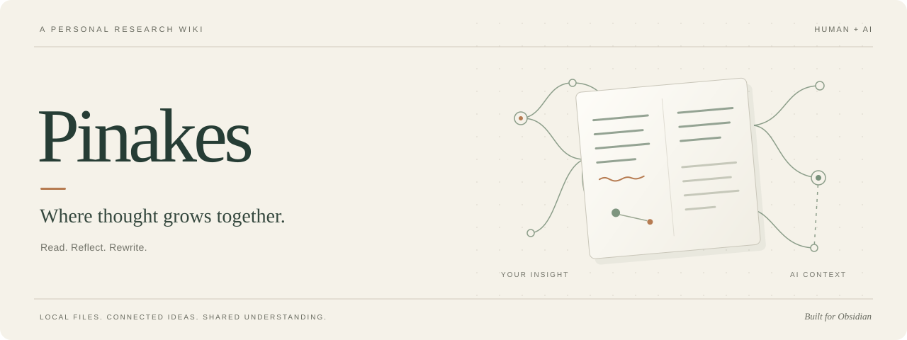

<div align="center">

**[简体中文](README.md) · English**



# Pinakes

### Where thought grows together.

Clear for you. Context for AI.<br>
Read papers, refine notes, and connect ideas in a personal knowledge base you can build together.

[](https://obsidian.md)
[](https://github.com/iWuji/Pinakes/releases)
[](#data-and-network)

**[Get started](#get-started) · [Install](#installation) · [User guide](docs/guide.md) · [Documentation](docs/README.md)**

</div>

<br>

**Pinakes is an Obsidian desktop plugin and a personal research wiki shared by you and AI.** Papers, research notes, relationships, and your own ideas live in local files. You read and edit them in Obsidian; an AI agent organizes and maintains them using the same conventions.

**The paper wiki's organization draws on Andrej Karpathy's [LLM Wiki](docs/llm-wiki.md)** ([original source](https://gist.github.com/karpathy/442a6bf555914893e9891c11519de94f)). Pinakes builds on its approach of turning source material into an evolving collection of linked notes, adding visual navigation, direct editing, and explicit collaboration conventions for paper research. A complete copy of the original is included in this repository.

## Make AI-organized knowledge a place for your own thinking

AI can summarize a paper quickly. What deserves to stay with it is what you notice: a passage worth revisiting, a question left unanswered, or a connection to your current research.

In Pinakes, follow the topic tree to a paper and explore the graph to see which work it builds on or borrows from. Open the note, check the source, rewrite an explanation, and add your own judgment. When you ask AI to continue, those edits and ideas remain in the same knowledge base as context for its next task.

| You interpret and decide | AI organizes and connects | The knowledge stays with you |
| --- | --- | --- |
| Read the source, correct explanations, and record questions and ideas | Follow conventions to check for duplicates, write notes, add supported relationships, and maintain indexes | Editable Markdown notes and local PDFs that are easy to back up and move |

**The graph reveals connections. Notes explain them. Editing makes them part of your own thinking.**

## From papers to your ideas

- **Collect**: import a PDF with “Add paper.” Pinakes tries to extract metadata and creates a note outline, keeping the original file intact. You can also create a note and add the PDF later.
- **Understand**: read the source alongside your notes, recording mechanisms, equations, experiments, and limitations. Obsidian displays equations, images, and Mermaid diagrams natively.
- **Connect**: browse by research topic and use the graph to view and edit relationships: extensions, reuse, competing approaches, and conflicting conclusions.
- **Add your judgment**: edit the text, reading status, importance, and tags. Develop your annotations into research reviews, ideas, and experiment plans.
- **Keep exploring**: ask AI to read your existing notes and ideas, then continue organizing them while preserving source evidence and your own judgments.

You and AI read and write the same notes. Edit the text directly, or change properties and relationships in the interface; the changes are saved to Markdown.

## Get started

The current plugin interface and detailed project guides are primarily in Chinese. The steps below include the Chinese labels you will see in Obsidian.

1. [Install Pinakes](#installation), open a new Obsidian vault, and enable the plugin.
2. In the command palette, search for **「打开关系图谱」** (“Open relationship graph”), then click **「添加论文」** (“Add paper”) in the top bar and choose a PDF.
3. Review the extracted information and save. New papers go into **「待归档」** (“Unfiled”). Once you choose a research topic, drag the paper into that topic in the tree.
4. Open the note to read, edit, and add your ideas. Use the workflow below when you want AI to help.

Opening the graph in an empty vault creates a research overview, a paper library entry, and an unfiled section. For a vault with existing notes, consult the [user guide (Chinese)](docs/guide.md) to set up the expected structure. The plugin does not automatically reorganize existing notes.

### One line for your AI agent

In this project's source workspace, have an agent with local file access and PDF-reading capabilities read `AGENTS.md`. Then give it a simple instruction:

```text
ingest /path/to/paper.pdf
```

You can also provide a paper title or an arXiv link. Under the [ingestion conventions (Chinese)](docs/wiki-conventions.md#7-录入流程), the agent should check for duplicates, read the full paper, complete the note and metadata, add supported relationships, rebuild indexes, and run validation. If you have already imported the paper through Pinakes, it should complete the existing note while preserving your edits and ideas.

You can add your research priorities:

> Focus on whether its training objective could work in my approach. Keep the evidence, limitations, and my own ideas clearly separated.

The current wiki conventions use Chinese for note prose and retain original English paper titles. If you want a different writing language, specify it to your agent.

`ingest` is a task convention for an external agent. Reading and writing are handled by the AI tool you choose; Pinakes provides the browsing and editing interface, wiki conventions, and validation tools. First-time setup and instructions for a vault outside this repository are covered in the [AI collaboration guide (Chinese)](docs/guide.md#与-ai-协作).

## Installation

Supports **Obsidian desktop on macOS, Windows, and Linux**. Pinakes is not currently listed in the community plugin directory.

### Already have an Obsidian vault? Install the plugin

1. Download **`main.js`, `manifest.json`, and `styles.css`** from the same version on the [Releases page](https://github.com/iWuji/Pinakes/releases).
2. Create `.obsidian/plugins/pinakes-explorer/` inside your vault and place all three files there.
3. Restart Obsidian and enable **Pinakes** under **Settings → Community plugins**.

Pinakes itself requires **Obsidian 1.7.0 or later**. It does not require other community plugins, Python, or AI tools. To build from source, see the [development guide (Chinese)](docs/development.md).

To update, disable the plugin, replace the three files, and enable it again. Keep `data.json` to preserve your settings. Uninstalling the plugin leaves your paper notes and PDFs in place.

### Starting fresh? Install the complete research vault

Download **`Pinakes-Installer.zip`** from Releases and extract it. Run `install.command` on macOS, `install.bat` on Windows, or `install.sh` on Linux. Open the installed directory in Obsidian and follow the prompts to trust and enable the plugins.

The complete vault includes the empty library structure, dashboards, note templates, and **Pinakes plus eight companion plugins**. It requires **Obsidian 1.13.3 or later**. Install it into a new directory; see the [full installation guide (Chinese)](docs/installation.md) for details.

Use Pinakes **“Add paper”** as the main import entry. QuickAdd is an optional template shortcut, PDF++ enhances annotations and references, and Dataview powers the reading dashboards. Enable the companions you need. Equations, images, and Mermaid rendering are built into Obsidian. See [companion plugins and dependencies (Chinese)](docs/plugins.md) for the full breakdown.

## Data and network

Paper notes, relationships, and reading properties are stored in Markdown files in your vault. Plugin settings live in `.obsidian/plugins/pinakes-explorer/data.json`. At your direction, Pinakes can copy PDFs, move paper folders, and edit properties and links. Back up your vault regularly.

PDF metadata extraction starts with local content. If an arXiv identifier is detected, Pinakes may query the arXiv API for additional metadata. External resources open in the system's default application; SSH entries copy a connection command. Pinakes has no telemetry and does not upload paper text or your entire vault. When you use an external AI tool, its handling of your material depends on that tool and your settings.

## Documentation and feedback

The linked guides below are currently in Chinese; the included LLM Wiki source is in English.

| What you want to do | Start here |
| --- | --- |
| Import, read, organize, and edit relationships | [User guide](docs/guide.md) |
| Install the complete vault and choose companion plugins | [Installation](docs/installation.md) · [Companion plugins](docs/plugins.md) |
| Have AI follow consistent reading and writing conventions | [Wiki conventions](docs/wiki-conventions.md) · [Tool reference](docs/tools.md) |
| Build, develop, or release | [Development](docs/development.md) · [Releasing](docs/releasing.md) |
| Browse all guides and the original reference | [Documentation index](docs/README.md) |

Questions and suggestions are welcome through [Issues](https://github.com/iWuji/Pinakes/issues). For a bug report, include your Obsidian and Pinakes versions, operating system, and steps to reproduce. Remove personal information from any examples.

This repository publishes the plugin, tools, templates, and conventions. Personal paper PDFs, research notes, reviews, and idea documents are excluded from version control.

---

<p align="center"><sub>Pinakes · Let every shared reading become the beginning of your next idea.</sub></p>
