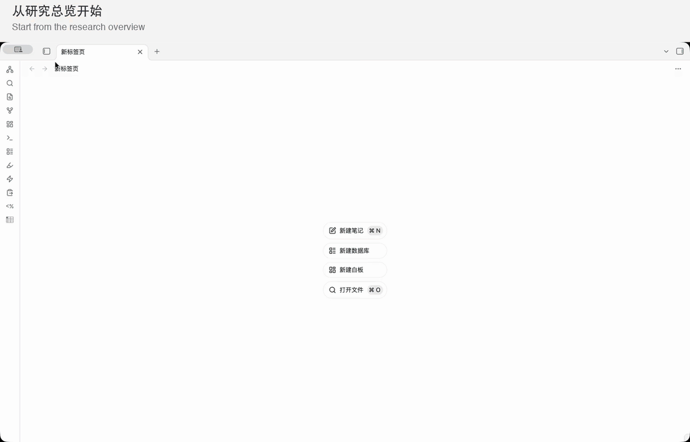

# 实际操作演示

从数百篇论文的研究库中找到一篇论文，再沿着它的联系继续阅读。下面是一次本地 Obsidian 实际操作的连续演示，配有中英文步骤提示。

[查看更清晰、可暂停的视频（MP4）](pinakes-demo.mp4) · [English walkthrough](#english-walkthrough) · [完整使用指南](guide.md)

## 看什么

1. **研究总览**：打开图谱，查看整库论文与研究方向。
2. **关系浏览**：缩放图谱，沿着不同方向的论文联系探索。
3. **结构化笔记**：打开论文笔记，查看标题、阅读状态、方向和关系等属性。
4. **对照原文**：将 PDF 与笔记并排打开，阅读论文解释与研究问题。
5. **继续探索**：回到图谱，在不同方向和论文之间切换。
6. **添加论文入口**：打开导入表单，查看 PDF 选择与元数据字段。

图中的连线来自知识库中已有的笔记与关系记录。录屏展示了添加表单，但没有执行导入；完整操作步骤见 [使用指南](guide.md)。让 AI 补全笔记前，请先配置 [AI 协作入口](guide.md#与-ai-协作)，然后使用 `ingest` 约定。

演示由用户提供的原始录屏剪辑而成，裁去黑边、压缩重复操作与等待，并移除链接提示弹窗片段；没有重绘产品界面。示例论文、PDF 与研究正文不随安装包分发，新库从空库骨架开始。

## English walkthrough

The animation above is a continuous demo edited from a real local Obsidian research session, with bilingual captions. [Open the MP4 version](pinakes-demo.mp4) for clearer playback and pause controls.

1. **Research overview.** Open the graph to see the library and its research topics.
2. **Graph exploration.** Zoom and follow connections across topics.
3. **Structured notes.** Open a paper note and inspect its metadata and relationships.
4. **Read alongside the source.** View the PDF and note side by side to compare explanations and research questions.
5. **Keep exploring.** Return to the graph and switch between topics and papers.
6. **Add paper entry.** Open the import form to see PDF selection and metadata fields.

The recording opens the import form without completing an import. Full instructions are in the [user guide (Chinese)](guide.md).

The edit removes black borders, repeated actions, waiting, and link-notification segments, without redrawing the interface. Example papers, PDFs, and research notes are not bundled with the installer. New libraries start with a minimal structure.
