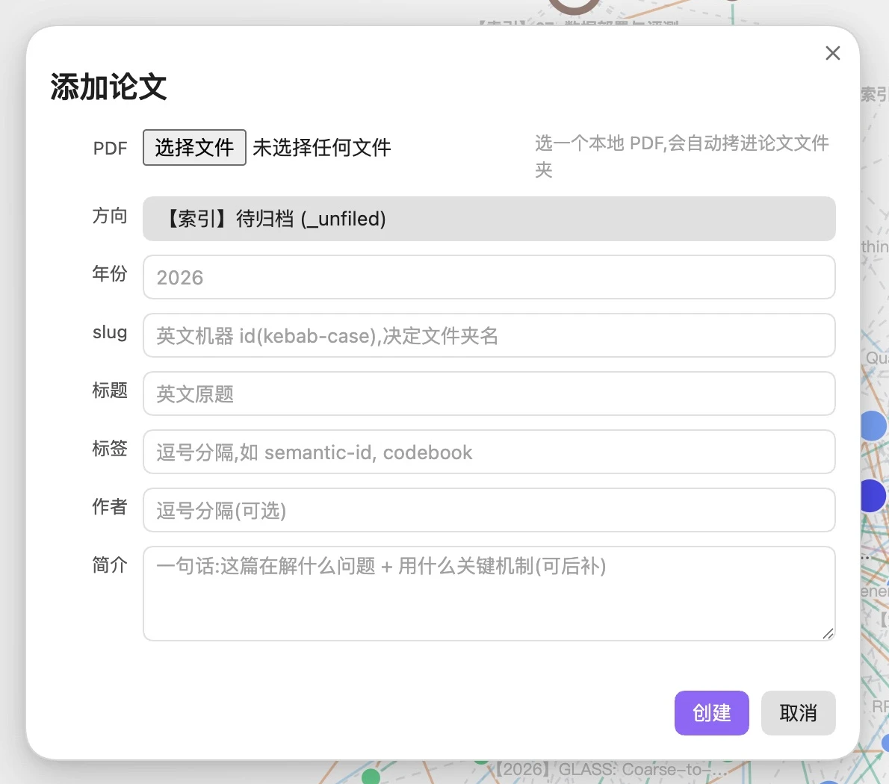
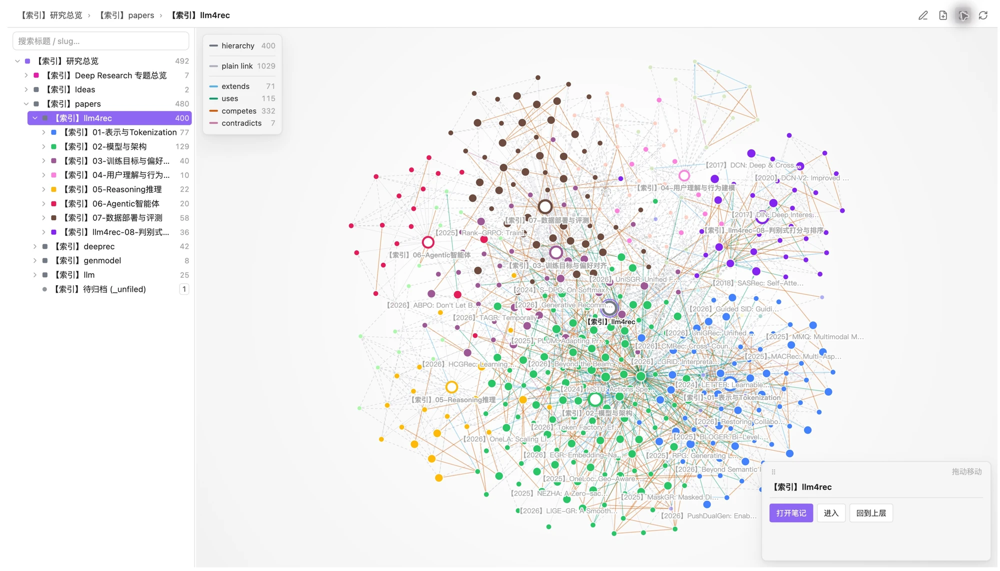
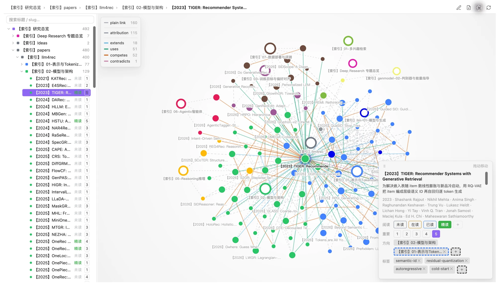

# 实际界面与三步图解

以下图片直接截自本地 Obsidian 中实际使用的 Pinakes 研究库，做了裁切与压缩，没有重绘产品界面。论文标题用于展示操作，示例论文、PDF 和研究正文不随安装包分发。界面和数量会随版本与知识库内容变化。

[English walkthrough](#english-walkthrough) · [完整使用指南](guide.md)

## 1. 把论文收进来

在关系图谱顶栏点击「添加论文」，选择本地 PDF。Pinakes 会尝试提取元数据；核对年份、标题和方向，再点击「创建」。不确定方向时，先放在「待归档」。



这张图展示尚未选择文件的真实表单。导入会复制 PDF 并创建笔记骨架；正文解读可以自己写，也可以交给 agent 按规范补全。

## 2. 从方向找到论文

展开左侧目录树，选择一个研究方向，右侧显示对应的连接子图。不同方向以颜色区分，也能看到跨方向的联系。库大了以后，可以在左上角按标题或 slug 搜索。



这是一份已经积累数百篇论文的研究库。新安装的空库从最小骨架开始，你可以按自己的研究主题逐步建立方向。

## 3. 看清联系，留下自己的判断

选择一篇论文，图谱随之聚焦，详情卡显示简介、阅读状态、重要度、方向与标签。图例中的 `extends`、`uses`、`competes`、`contradicts` 分别表示改进、复用、竞争与结论分歧。



阅读状态、重要度与标签可以直接在卡片中修改；打开笔记后，可以核对解释、补充证据，写下自己的疑问与想法。关系编辑从顶栏铅笔入口进入，具体操作见 [使用指南](guide.md)。

需要 AI 补全已导入的论文时，在配置好的项目工作区告诉它：

```text
ingest TIGER 这篇论文，补全已有笔记，保留我的修改和想法。
```

首次配置及录入要求见 [AI 协作说明](guide.md#与-ai-协作)。本次截图只浏览已有论文与打开添加表单，没有创建或修改研究笔记。

## English walkthrough

These are real screenshots of Pinakes running in a local Obsidian research vault, cropped and compressed without redrawing the interface. Example papers, PDFs, and research notes are not included in the installer. The interface is currently in Chinese.

1. **Add a paper.** Click 「添加论文」 in the graph toolbar, choose a local PDF, review the extracted metadata, and click 「创建」. Use 「待归档」 (Unfiled) until you decide on a topic. The [form screenshot](pinakes-add-paper.webp) shows the initial state before choosing a file. Importing copies the PDF and creates a note outline; you or your agent can complete the analysis.
2. **Browse a topic.** Expand the tree and select a research topic to explore its connected subgraph. Colors distinguish topics, while links reveal connections across them. Search by title or slug when the library grows. The [overview screenshot](pinakes-overview.webp) comes from an established library; a new installation starts with a minimal structure.
3. **Explore and refine.** Select a paper to focus its graph and inspect its summary and properties. The [TIGER screenshot](pinakes-paper-relations.webp) shows reading status, importance, topics, and tags. Edit the properties in the card, then open the note to check explanations and add your own ideas. The pencil button opens relationship editing; `extends`, `uses`, `competes`, and `contradicts` distinguish the kinds of connections.

For an imported paper, ask your configured agent: “ingest TIGER; complete the existing note and preserve my edits and ideas.” See the [AI setup guide (Chinese)](guide.md#与-ai-协作). Capturing these screens did not create or modify research notes.
