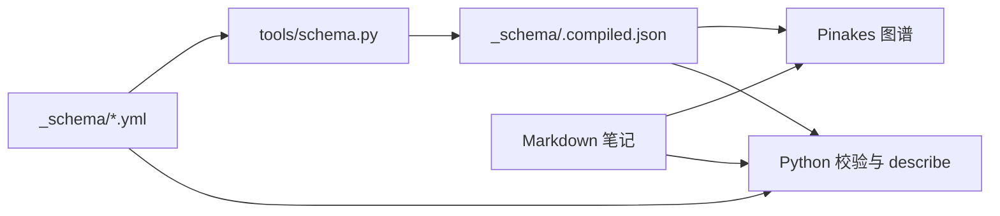

# 实体模型

Pinakes 用一篇 Markdown 笔记描述一个实体。论文、研究方向、专题和想法都可以成为实体；笔记记录它的名称、属性和关联，资源本体可以放在知识库中，也可以由 `locator` 指向外部位置。

本文说明这些实体如何被识别、组织和呈现。笔记的写作与录入规则见 [知识库约定](wiki-conventions.md)，命令用法见 [工具手册](tools.md)。

## 0. 数据结构

实体的基本信息放在 frontmatter 中：

```yaml
---
kind: topic
title: "【Deep Research】语义编码"
depth: self
locator: "file:///path/to/research-materials"
---
```

`kind` 决定默认行为，`depth` 限定层级展开深度，`locator` 指向可选的外部资源。论文还包含年份、标签、阅读状态等属性。

## 1. 数据与配置

知识内容存放在 Markdown 和附件中。实体类型与字段定义位于知识库的 `_schema/`：

| 文件 | 内容 |
| --- | --- |
| `kinds.yml` | 实体类型、路径识别规则、容器小节与默认行为 |
| `fields.yml` | 字段类型、取值、适用实体与展示约定 |
| `.compiled.json` | 由 YAML 编译得到，供插件读取 |

修改 YAML 后运行 `python3 tools/pinakes.py schema --apply`。`lint` 会检查编译结果是否过期。插件缺少编译文件时使用内置的兼容定义。



标签和关系词表目前仍在 `tools/` 中，分别由 `tag_vocabulary.yml` 和 `relation_vocabulary.yml` 维护。

## 2. 实体字段

| 字段 | 含义 | 当前行为 |
| --- | --- | --- |
| `kind` | 实体类型 | 插件优先使用显式值，缺省时按路径推断 |
| `title` | 显示名称 | 用于树、图谱和详情卡；论文索引也从它取标题 |
| `depth` | 层级展开深度 | 实例值覆盖类型的默认深度 |
| `locator` | 外部资源位置 | 解析为本地路径、Git 仓库、SSH 位置或网页 |
| `parent` | 显式父实体声明 | 已注册，当前插件尚未用它调整树层级 |

`kind` 的路径推断按 `detect` 中的顺序匹配，第一条命中后停止。现有论文和索引可以依靠路径识别，不必逐篇补写类型。

Python 的 `describe` 和 `lint` 目前主要按路径判断类型，与插件的显式 `kind` 优先规则存在差别。新增类型需要同时登记类型定义和路径识别规则，并检查两端行为。

### 2.1 资源位置

| `locator` 形式 | 打开方式 |
| --- | --- |
| 省略 | 在 Obsidian 中打开笔记或所在目录 |
| `file:///absolute/path` | 使用系统文件管理器或默认应用 |
| `/absolute/path`、`~/path` | 插件按本地路径处理 |
| `git@host:group/repo.git` | 转换为 HTTPS 仓库地址，在浏览器打开 |
| `https://host/group/repo.git` | 去掉 `.git` 后在浏览器打开 |
| `ssh://user@host:/path` | 复制 `ssh user@host` 命令 |
| `https://...`、`http://...` | 在浏览器打开 |

资源引用不会自动同步或复制内容。本地路径不存在时，笔记仍保留，插件标记资源不可达。远程地址不做网络探测，因此可打开的地址不代表资源已验证可达。

SSH 的路径部分目前仅被解析，打开动作不会自动进入该目录，也没有自动启动远程 IDE。

## 3. 实体类型

当前研究知识库使用以下类型。具体识别规则以 [kinds.yml](../wiki/_schema/kinds.yml) 为准。

| 类型 | 用途 | 默认深度 | 子节点来源 | 进度字段 |
| --- | --- | --- | --- | --- |
| `root` | 研究总览 | `full` | `## 大类别` | — |
| `library` | 论文库入口 | `full` | `## 大类别`、`## 待归档` | — |
| `domain` | 一个研究域 | `full` | `## 方向` | — |
| `direction` | 一个研究方向 | `full` | `## 论文` 与目录 | — |
| `partition` | 待归档分区 | `full` | `## 论文` 与目录 | — |
| `paper` | 论文笔记 | `full` | 叶子实体 | `reading` |
| `topic_library` | 专题总览 | `full` | 目录 | — |
| `topic` | 专题报告 | `self` | 叶子实体 | — |
| `idea_library` | Ideas 入口 | `full` | 目录 | — |
| `idea_package` | 一个方案包 | `full` | 目录 | — |
| `idea` | 方案稿 | `self` | 叶子实体 | `stage` |

### 3.1 类型的行为声明

`kinds.yml` 中的声明包括：

| 声明 | 用途 |
| --- | --- |
| `rep`、`scan.rep_patterns` | 标记目录中的代表笔记 |
| `children_section`、`children_sections` | 指定容器正文中列子节点的小节 |
| `default_depth` | 默认展开深度 |
| `leaf`、`member_kind` | 描述叶子与容器成员类型 |
| `naming`、`naming_fields` | 描述命名格式及其来源字段 |
| `index_columns` | 方向索引的表头 |
| `status_field` | 详情卡与树中的进度字段 |
| `root_dir` | 这类实体所在的顶层目录 |

插件当前识别 `reading` 和 `stage` 两个进度字段。未声明进度字段的类型不显示状态行。方向移动、新建论文等操作通过 `member_kind: paper` 对应的 `root_dir` 找到论文树。

这些声明让路径和部分展示行为可以配置。论文命名、表格行内容和字段编辑仍有专用实现；新增任意类型或进度字段，还需要确认代码是否支持。

## 4. 展开深度

| `depth` | 树中的表现 |
| --- | --- |
| `self` | 保留实体自身，隐藏子层级 |
| `1` | 最多保留直接子节点 |
| `2` 等正整数 | 最多保留对应层数 |
| `full` | 不在该节点增加深度限制 |

实例可以覆盖类型的默认值，父节点的限制也会向下传递。因此，父节点设为 `self` 后，即使子节点设为 `full`，子层级仍不会展开。

插件将显式或默认深度不是 `full` 的实体标为边界节点，用虚线外圈表示。详情卡可以查看资源概况并打开所在位置；本地目录概况只统计一层，最多 5000 项。

深度调整只改变层级展示，不会删除、改名或补建内部文件。扫描得到的节点仍在数据索引中，可能通过已有关系出现在子图里。当前不能把 `depth` 当作访问控制，也不能据此假定所有工具都会跳过内部文件。

## 5. 层级的来源

插件先按目录构建树，再按容器小节中的链接调整归属。

一个目录中只有一篇匹配代表模式的笔记时，该笔记代表目录；没有代表笔记或有多个候选时，内部节点上提。论文自己的 `【年份】slug/` 文件夹因此不会额外变成一个图谱节点。

容器小节补足目录无法表达的层级。例如，域索引与方向文件夹平铺在 `papers/` 下，域笔记的 `## 方向` 用链接声明它包含哪些方向。这些小节链接优先于先前推导的目录归属。

```text
研究总览
├── 论文库
│   ├── 域 → 方向 → 论文
│   └── 待归档 → 论文
├── 专题总览 → 专题
└── Ideas → 方案包 → 方案稿
```

同一个子节点应由一个容器认领，避免冲突和环。`parent` 字段虽然已经登记，目前不参与这一步；`lint` 也尚无通用的 `parent-conflict` 检查。

层级之外，论文关系、子方向和正文引用形成图中的关联边。具体语义见 [知识库关系约定](wiki-conventions.md#31-关系字段)。

## 6. 属性与字段注册

可编辑属性直接保存在 frontmatter 中。[fields.yml](../wiki/_schema/fields.yml) 记录字段的类型、取值范围、适用实体和展示约定，例如 `importance` 对应节点大小，`reading` 对应状态徽标。

当前插件仍直接处理标题、标签、重要度和两个进度字段。`encode` 是展示约定，尚未成为支持任意字段的通用渲染器。

论文中的未注册字段会累计使用次数，默认在至少三篇中出现后给出一次 `field-promotable` 提示。确定它是长期使用的属性，再登记进字段表。废弃字段单独提示。

关系类型还需要同步插件中的 `REL_KEYS` 和 `REL_META`；它们包含图谱识别的字段、颜色与对称性。仅修改关系 YAML，不会让插件自动识别新类型。

## 7. 校验范围

`lint` 检查论文的名称、字段、PDF、标签、关系与方向索引，也检查普通相对链接和公式写法。它会报告过期的 schema 编译文件。

当前深度处理并未完全统一：深度不是 `full` 的论文会跳过大部分论文检查，对应的方向索引也可跳过过期检查；普通链接检查仍遍历知识库，目录结构检查和索引重建也不都受父节点深度限制。

因此，边界表示可自由组织的内部结构，但不承诺内部文件完全不被扫描。通用的按深度校验需要继续完善。

`error` 表示结构或数据问题，默认令命令失败；`warn` 表示待补或待核对事项，使用 `--strict` 时也令命令失败。

## 8. 使用与扩展

研究库现有的目录、字段和命名可以继续使用。类型缺省时按路径推断，深度缺省时使用类型默认值。

另一套知识库可以使用自己的 `_schema/`，配置根笔记、识别规则、容器小节和顶层目录。当前 schema 未注册 `project` 类型；项目库需要自行定义，并核对它所需的状态和操作支持。

修改 schema 后编译，再运行校验和图谱测试。更换顶层目录时，也要检查 Python 工具；其中部分命令仍按研究库的 `papers/` 布局工作。

## 9. 机器可读描述

命令行与插件都提供结构描述：

```bash
python3 tools/pinakes.py describe --json
```

Obsidian 中对应「描述库结构」命令。输出字段包括：

| 字段 | 内容 |
| --- | --- |
| `schema_version` | 配置版本 |
| `kinds`、`fields` | 实体类型与字段定义 |
| `unknown` | 未注册字段策略 |
| `instances` | 实体路径、类型、深度、标题及可选资源信息 |
| `boundaries` | 深度不是 `full` 的实体路径 |
| `unreachable` | 已检测到的本地资源问题 |
| `operations` | 操作名称列表 |

两个入口使用同一份 schema，输出结构对应；实例集合、排序和本地路径检测可能有差别，不承诺逐字相同。Python 目前只检测 `file://` 形式的本地资源，插件还接受绝对路径与 `~/`。

`operations` 描述支持的操作名称，不是一个可调用的统一写入 API。写入仍通过现有脚本或插件完成。agent 操作前应读取约定、确认资源边界；批量修改先预览，结束后检查名称、链接和索引。

## 10. 后续完善

当前尚需统一的部分包括：显式 `kind` 与 `parent` 的处理、工具对父节点深度的遵循、任意属性的渲染与编辑，以及两个结构描述入口的实例口径。

标签和关系词表是否迁入 `_schema/` 也尚未决定。现阶段保持现有位置，扩展时同步其使用方。
